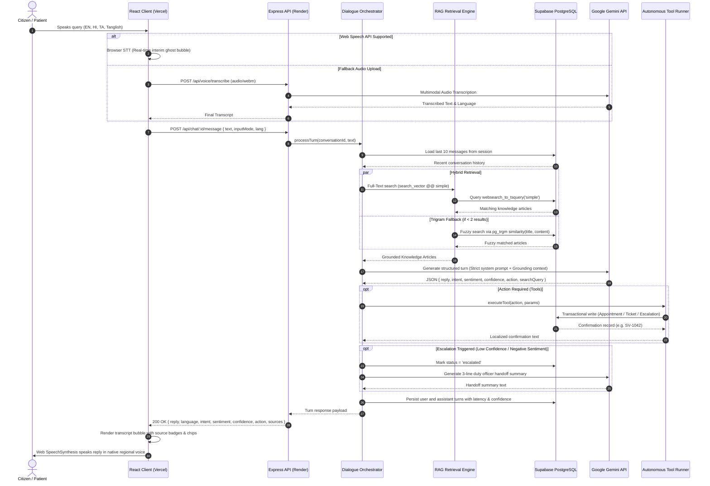
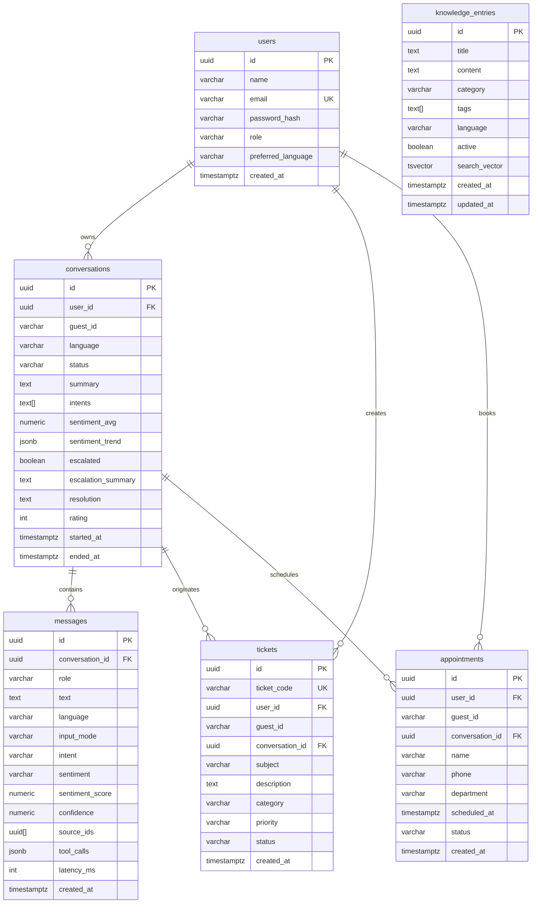

# SamvadAI Architecture & System Design

SamvadAI is built with a voice-first, decoupled, layered architecture prioritizing ultra-low dialogue latency, zero-hallucination factual grounding, accessibility, and end-to-end data privacy.

---

## 1. High-Level Architecture Sequence

---

## 2. Database Entity-Relationship Diagram (Supabase PostgreSQL)

---

## 3. Grounding & Anti-Hallucination Design

SamvadAI prevents hallucinations through a 4-tier pipeline:

1. **Strict Context Boundaries:**
   The model is instructed:
   > *"Answer questions ONLY using facts provided in the KNOWLEDGE CONTEXT. If the information is not present or partial, state that you do not have that specific record and offer human escalation."*
2. **Deterministic Source Attribution:**
   Articles retrieved from PostgreSQL full-text search are injected with UUID tags (`[ID: ...]`). The model returns `usedSourceIds`, which are validated against the actual retrieved docs and rendered in the UI as clickable source badges (e.g., `From: OPD Timings and Registration`).
3. **Escalation Rules Engine:**
   - Confidence threshold: If model confidence < 0.35 on two consecutive turns, the system flags the interaction and routes to a human duty officer.
   - Sentiment trigger: If 3 consecutive turns register negative sentiment (-0.6 or lower), automated escalation triggers.
   - Explicit keyword: Direct requests ("transfer to human", "doctor se baat karni hai") initiate immediate handoff.
4. **Prompt-Injection Defense:**
   User conversational turns are treated strictly as data payloads inside delimiters, preventing users from overriding system instructions or revealing prompt context.
